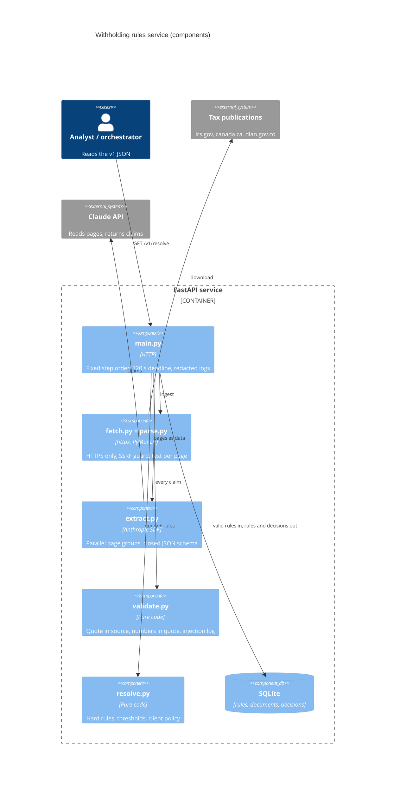

# Withholding rules service

Reads official tax publications, answers "does withholding apply to this payment, and at what
rate", and flags what a human must decide. Live: <https://withholding.pixanai.com> (with a small UI).
Repo: <https://github.com/SerchFGA/withholding-rules-service>.

**How it works.** The model is used once, at ingestion, only to read: it returns structured claims
from a closed vocabulary. Code checks every claim against the source (quote, page, rate, amounts, tax
year, jurisdiction) and discards what it cannot verify. `payment_type` and `condition` remain the
model's label, with one guard: a quote that carries a caveat ("certain kinds", "unless", "generally",
"exempt") is never stored as unconditional, so it always asks for review. `GET /v1/resolve` never
calls a model: it is a lookup over validated rules plus the three hard rules, in a fixed order, in
`app/resolve.py`.

## Run it

```bash
python3 -m venv .venv && .venv/bin/pip install -r requirements-dev.txt   # Windows: .venv\Scripts\pip
cp .env.example .env        # set ANTHROPIC_API_KEY (ingestion calls Claude) and INGEST_KEY
make verify                 # uses .venv automatically; without make: .venv/bin/python scripts/verify.py
make run                    # http://localhost:8000
```

`make verify` starts from an empty SQLite file, ingests the five documents over the network with the
real model, runs the 309 tests and the 27-query evaluation set, and prints PASS/FAIL per R1 to R7, a
corpus line and accuracy. It needs **your own `ANTHROPIC_API_KEY`**: no key and no recorded model answer is in this
repository, the image or any prompt (recorded answers would be seeding).

| Endpoint | Purpose |
|---|---|
| `POST /v1/documents` `{"source_url"}` + header `X-Ingest-Key` | Ingest one publication (PDF, HTML or image). Same URL, bytes and pipeline version: no new rows, zero model calls |
| `GET /v1/rules?jurisdiction=&payment_type=&tax_year=&limit=&offset=` | Validated rules with page and verbatim quote |
| `GET /v1/resolve?payment_type=&amount=&jurisdiction=&tax_year=[&payee_type=]` | The v1 contract, unchanged, plus additive fields |
| `GET /v1/documents`, `GET /health`, `GET /` | Ingested documents, liveness, UI |

Additive fields: `policy_outcome` (client policy applied; `outcome` stays the unadjusted result),
`policy_applied`, `security_events`, `decision_trace`, `request_id`. `payee_type`
(`government`, `non_resident`, `resident`) is an **optional parameter I added**: two hard rules depend
on who is paid and the sample query does not say. Without it, a "do not withhold" answer is flagged.



## Decisions and what I rejected

- **Extract at ingestion, resolve in code.** Rejected RAG with embeddings: similarity is approximate and puts a model in the request path (R1, R3).
- **A quote must exist verbatim, contain the rate and threshold, and speak of withholding.** A literal-quote check alone lets through real traps: "24%" is a tax bracket in Rev. Proc. 2023-34 and "30%" an estimated-tax factor in Pub. 505 p. 28.
- **Unknown is `null` plus review, never `false`** (R4). The contract has no other way to say "unknown".
- **Flat rates with an optional threshold only.** Caps, additive brackets and lookup tables are stored as unsupported and force review. Rejected modelling them: not within 1,500 lines.
- **Scanned pages are transcribed, then validated like any page, and always flagged.** Rejected trusting what the model says an image contains.
- **A source outside the official-site list is accepted, but every rule from it asks for review** (`source_not_on_allowlist`). Rejected a hard allowlist: the live round brings a site I cannot list in advance.
- **An embedded instruction is recorded in `security_events` and changes neither answer nor flag.** Shown in `tests/test_api.py::test_embedded_instruction_cannot_change_the_answer_and_is_recorded`.
- **Own VPS (Easypanel, Docker, SQLite on a volume).** Rejected Vercel (no disk) and Cloudflare free tier (10 ms CPU). I read "any free host" as permission, not a ban on a server I already run.
- **Logs** (JSON lines): inputs, each step, thresholds, rule page/rate/model version, rules hash. **Redacted:** the amount (logged only as a band), keys, URL credentials and query strings. **Boundary:** `app/logs.py`; the exact amount exists only in memory for the request. No access log. Documents over 300 pages are refused before any model call; responses carry `nosniff`, `DENY` framing and `no-referrer`. CI runs the tests and the 1,500-line cap on every push.

## What was run, and what was not (2026-11-19)

- **Production:** five documents ingested by the pipeline (first from an empty database, then re-read once after the pipeline version changed) in 57 s total (slowest 20 s), 37 rules, 2 claims discarded. Evaluation: **25/27**. Misses: supplemental wages returns `conflicting_rules` with review instead of the optional 22%; the Ontario EI premium returns the right 1.63% but without the annual-maximum warning, because that run did not extract the cap.
- **Extraction varies between runs** by one or two cases; effort `medium` reduced it. Expect accuracy to move.
- **Ontario:** the URL in the brief (`t4032on-1-26e.pdf`) returns 404; I use the current official file, `t4032-on-1-26e.pdf`. canada.ca drops some automated clients: from my laptop it times out, so there `make verify` reports the corpus line as FAIL for that one document. From the server it downloads.
- **Designed, not exercised:** transcription of scanned pages against the real model (simulated model only); the "higher of percentage or flat amount" policy on real data (no live rule states both); the DNS-rebinding window in `fetch.py`; HTML with unclosed `header`/`nav` tags.

## With more time

- **Security:** strip invisible PDF text (white or microscopic) before validating quotes; rate limits and a spending budget per ingest key; parse documents in a separate sandboxed container; pin the resolved IP to close the DNS-rebinding window; validate `payment_type` and `condition` against the text, not only the vocabulary.
- **Answers:** thresholds with a direction (floor or cap), additive brackets and lookup tables; richer queries (payee TIN status, kind of gambling, pay period) so conditions are evaluated instead of flagged; read each page twice and keep only agreeing claims, to stop run-to-run drift.
- **Operations:** asynchronous ingestion (202 plus status) for documents that do not fit in 120 s; versioned rule sets to answer "as of a date"; a review endpoint for analysts; nightly `make verify` and an alert when a publication's hash changes; volume backups; log token usage per document before optimizing cost.
- **Cost and speed:** a cheap model to pick pages that mention withholding before the expensive one reads them (Rev. Proc. 2023-34 cost 7 calls for 0 rules); Batch API for nightly re-reads; cache `rules_version` on write and index rules by jurisdiction and payment type.

## Something I think is wrong

1. **What:** the hard rule "amount below the publication's threshold: do not withhold", and the 30% non-resident minimum, are fixed in code as if the publications said so.
2. **Why:** they do not. Pub. 505 p. 12 keeps 24% backup withholding below the $5,000 gambling threshold; the social security figure ($184,500) is a ceiling, where "below: do not withhold" is backwards; no document states 30% as a withholding rate for non-residents (its one appearance, Pub. 505 p. 28, is an estimated-tax factor).
3. **Alternative:** treat thresholds as extracted data with a direction (floor or cap) and conditions, and keep hard rules as guardrails that must cite a publication or be labelled as client policy.
4. **If the client insisted:** I would ship it as specified, which is what this does, but keep flagging for review every case where the document contradicts the rule, and report those cases monthly.
5. **Evidence:** the `why` field of each case in `eval/cases.json`, with page and verbatim quote.
